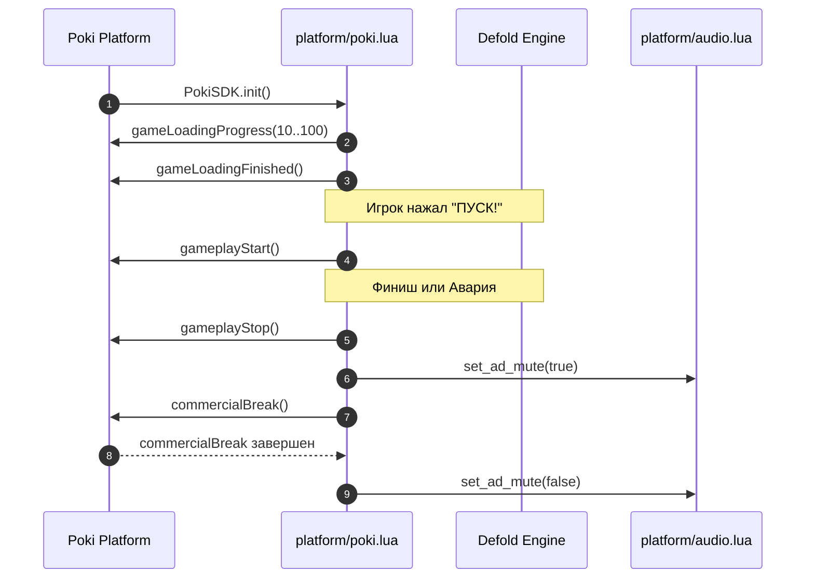

# Комплексный план улучшения и подготовки к релизу Bridge Mad
## Платформы: Poki (Web / HTML5) и Mobile (Mobile Web + Native Android / iOS)

> **Версия документа:** 1.0.0  
> **Проект:** Bridge Mad (Defold Engine, XPBD Physics, Voxel 3D)  
> **Целевые платформы:**  
> 1. **Poki Web / Desktop & Mobile Web** (Chrome, Safari, Edge, Chromebooks)  
> 2. **Mobile Platforms** (Android APK/AAB в Google Play, iOS в App Store, PWA)

---

## Содержание

1. [Аудит текущего состояния проекта](#1-аудит-текущего-состояния-проекта)
2. [Стратегические цели и ключевые метрики (KPI)](#2-стратегические-цели-и-ключевые-метрики-kpi)
3. [Направление 1: Оптимизация и соответствие требованиям Poki](#3-направление-1-оптимизация-и-соответствие-требованиям-poki)
4. [Направление 2: Адаптация под мобильные устройства (Touch & UX)](#4-направление-2-адаптация-под-мобильные-устройства-touch--ux)
5. [Направление 3: Сочность, Game Feel и эстетика Drive Mad](#5-направление-3-сочность-game-feel-и-эстетика-drive-mad)
6. [Направление 4: Обучение (FTUE), левел-дизайн и баланс](#6-направление-4-обучение-ftue-левел-дизайн-и-баланс)
7. [Направление 5: Мета-геймплей, кастомизация и удержание (Retention)](#7-направление-5-мета-геймплей-кастомизация-и-удержание-retention)
8. [Направление 6: Архитектура нативного мобильного билда (Android / iOS)](#8-направление-6-архитектура-нативного-мобильного-билда-android--ios)
9. [Пошаговая дорожная карта (Roadmap & Milestones)](#9-пошаговая-дорожная-карта-roadmap--milestones)
10. [Чек-лист перед публикацией и маркетинговые материалы](#10-чек-лист-перед-публикацией-и-маркетинговые-материалы)

---

## 1. Аудит текущего состояния проекта

### 1.1. Что уже реализовано на отлично
* **Собственный физический движок (XPBD):** Реализован на чистом Lua (`game/physics/`), не зависит от тяжелых внешних библиотек Box2D/Bullet, полностью детерминирован и автономен.
* **Архитектурная чистота:** Логика отделена от рендеринга Defold (`shared_state = 1`, FSM через `session.lua`, события через `events.lua`).
* **Размер бандла:** WebAssembly-сборка занимает всего **~1.57 МБ в ZIP** (`poki.zip`), что в 10 раз меньше лимита Poki (< 15 МБ) и гарантирует запуск за 1–2 секунды даже на слабом 3G/LTE.
* **Автотесты:** 52 файла без синтаксических ошибок, 24 уровня проверены автоматическим решением грузовиком, тесты рантайма и UI проходят стабильно (`tests/node run.js`).
* **Контентная база:** 24 уровня в 4 главах, 8 материалов, 3 типа транспорта с механикой звезд (мотоцикл ★, машина ★★, грузовик ★★★), порталы, батуты, ускорители, шипы.
* **Базовая интеграция Poki SDK:** Обертка `platform/poki.lua` реализует кулдауны рекламы (180 сек), автоглушение звука и тайм-аут на случай блокировщиков рекламы.

### 1.2. Выявленные точки роста (Gaps & Weaknesses)
1. **HTML5-оболочка (index.html):** Используется стандартный шаблон Defold со стандартным логотипом-сплэшем Defold и нижней полосой `.buttons-background` (42px), которая съедает полезную площадь и ломает бесшовность на портале.
2. **WebAudio / Safari Policy:** При первом открытии на мобильных устройствах звук может блокироваться политикой автоплея браузера, пока игрок явно не коснется экрана.
3. **Эргономика тач-ввода в стройке:** Палец закрывает строящийся узел при соединении на малых экранах смартфонов; отсутствует визуальный «лупа-прицел» или выносная точка привязки.
4. **Безопасные зоны (Safe Areas):** Вырезы экранов современных смартфонов (Notch, Dynamic Island) и нижняя системная панель жестов (Home Bar) могут перекрывать кнопки управления и педали.
5. **Сочность и Game Feel (Drive Mad Juice):** 
   * Не хватает динамического изменения тональности мотора (RPM pitch).
   * Нет звука натужного треска дерева/металла при пиковых нагрузках ($>70\%$ стресса) перед разломом.
   * Нет эффекта замедления (Micro Slow-Motion) в момент драматического спасения или эпичного крушения.
   * Партиклы разлета обломков сейчас базовые, отсутствуют следы шин на асфальте и воксельные брызги воды.
6. **Обучение (Onboarding):** Текстовые подсказки сверху экрана эффективны для ПК, но на веб-порталах (где 70%+ аудитории англоязычные дети и подростки) необходим анимированный жестовый туториал (рука с пальцем «тяни отсюда сюда»).
7. **Мета-гейминг:** Звезды открывают уровни, но сэкономленный бюджет никак не вознаграждается. Игроку не на что тратить виртуальные деньги (нет гаража, скинов, прокачки).
8. **Виброотклик (Haptics):** Полное отсутствие тактильной отдачи на мобильных устройствах (строительство, щелчок привязки, треск балки, авария).

---

## 2. Стратегические цели и ключевые метрики (KPI)

```
┌────────────────────────────────────────────────────────────────────────┐
│                        ЦЕЛЕВЫЕ ПОКАЗАТЕЛИ (KPI)                        │
├──────────────────────────┬──────────────────────┬──────────────────────┤
│ Метрика                  │ Текущее значение     │ Цель к релизу        │
├──────────────────────────┼──────────────────────┼──────────────────────┤
│ Размер бандла HTML5      │ 1.57 МБ              │ < 2.0 МБ (сохранить) │
│ Время загрузки (Mobile)  │ ~2.5 сек             │ < 1.8 сек            │
│ FPS (Low-end Android)    │ 45-55 FPS            │ Стабильные 60 FPS    │
│ D1 Retention (Poki)      │ Базовый              │ ≥ 28 - 32%           │
│ D7 Retention             │ -                    │ ≥ 9 - 12%            │
│ Среднее время сессии     │ ~4-5 мин             │ ≥ 8-10 мин           │
│ Ad Completion Rate       │ ~70%                 │ ≥ 92%                │
│ Прохождение 1-й главы    │ ~50%                 │ ≥ 85%                │
└──────────────────────────┴──────────────────────┴──────────────────────┘
```

---

## 3. Направление 1: Оптимизация и соответствие требованиям Poki

### 3.1. Кастомный HTML5-шаблон без стороннего брендинга
Создать файл `template/poki_template.html` и подключить его в `game.project` (`html5.htmlfile`):
* Удалить стандартный SVG-сплэш Defold и полоску `.buttons-background`.
* Внедрить прогресс-бар в палитре игры с инлайн-SVG логотипом (без +1.2 МБ к бандлу).
* Заблокировать контекстные меню браузера по долгому тапу (`contextmenu`), системный скролл и выделение текста.
* Гарантировать правильный viewport meta-тег:
  ```html
  <meta name="viewport" content="width=device-width, initial-scale=1.0, maximum-scale=1.0, user-scalable=0, viewport-fit=cover">
  ```

### 3.2. Полный цикл жизненного цикла Poki SDK v2
Проверить и дополнить `platform/poki.lua`:


1. **Коммерческие паузы (Commercial Break):**
   * Частота: Строго не чаще одного раза в 180 секунд.
   * Точки вызова: Только экран победы (кнопка «Дальше») либо выход в меню уровней. **Никогда** не вызывать во время стройки или вождения.
   * Первые 3 уровня — полный «зеленый коридор» без межстраничной рекламы (для максимизации воронки FTUE).
2. **Реклама с вознаграждением (Rewarded Break):**
   * **Подсказка чертежа (Hint):** Отображает эталонное решение полупрозрачной сеткой.
   * **Дополнительный бюджет (+25%):** Экстренная помощь, если мост чуть-чуть не дотягивает.
   * **Пропуск уровня (Skip):** Появляется после 3 поражений подряд.
   * Плеер Poki всегда получает награду при успешном просмотре, а игра корректно возобновляет звук.
3. **Безопасность и отсутствие зависаний:**
   * Тайм-аут колбэка рекламы: 35 секунд (если браузер блокирует трекер или связь прервалась — игра немедленно отпускает управление).
4. **Poki Inspector Test:**
   * Прохождение всех тестов в утилите [Poki Inspector](https://sdk.poki.com/): проверка паузы движка при открытии рекламы, глушения звука, отсутствия ошибок в консоли DevTools.

---

## 4. Направление 2: Адаптация под мобильные устройства (Touch & UX)

### 4.1. Учет экранных вырезов и безопасных зон (Safe Area Insets)
* Современные мобильные устройства имеют закругленные углы, «челки» и системный жестовый бар.
* Внедрить расчет отступов в `gui/layout.lua`:
  ```lua
  -- Передача безопасных отступов из HTML/SysInfo в виртуальные координаты
  function M.safe_insets()
      local top = 0
      local bottom = 0
      local left = 0
      local right = 0
      if html5 then
          -- Чтение CSS env(safe-area-inset-*) через JS-интерфейс
          local ok, json = pcall(html5.run, "JSON.stringify({top: parseInt(getComputedStyle(document.documentElement).getPropertyValue('--sat')||0), bottom: parseInt(getComputedStyle(document.documentElement).getPropertyValue('--sab')||0)})")
          -- Парсинг и применение масштаба виртуального холста
      end
      return left, right, top, bottom
  end
  ```
* Все кнопки в углах (Шестеренка, Звук, Сброс, Педали) автоматически сдвигаются внутрь безопасной зоны на мобильных устройствах.

### 4.2. Эргономика сенсорного строительства (Build Assist)
* **Проблема пальцевого перекрытия:** Когда игрок касается экрана пальцем (пятно контакта 8–12 мм), он физически не видит целевой узел или анкер.
* **Решение: "Offset Pin / Touch Lens":**
  1. В режиме перетаскивания балки точка привязки проецируется с вертикальным смещением на 35–45 виртуальных пикселей выше фактического касания пальца (палец находится *под* строящимся узлом, целевая точка полностью видна).
  2. Магнитный захват (Snap Assist): радиус автоматического прилипания к существующим узлам увеличивается на тач-устройствах с `34px` до `48px` (`TOUCH_TOLERANCE_PX`).
  3. Двухпальцевый жест Zoom/Pan (Pinch to Zoom): плавный переход между масштабированием моста и панорамированием рабочей зоны.

### 4.3. Оптимизация интерфейса вождения (Drive Mode Pedals)
* Расположение педалей:
  * **Тормоз / Наклон назад:** В левом нижнем углу под большой палец левой руки.
  * **Газ / Наклон вперед:** В правом нижнем углу под большой палец правой руки.
* Размер зон касания: педали увеличиваются на 15% на экранах смартфонов (диаметр 220px), с прозрачной расширенной зоной отклика (Touch Target Extension), исключающей ложные промахи.
* Визуальный отклик: трехмерное продавливание педали внутрь при зажатии с эффектом цветного свечения.

### 4.4. Интеграция тактильной отдачи (Haptics / Vibration)
Подключить Web Vibration API для мобильных браузеров и нативный вибро-плагин для Android:
* `navigator.vibrate(15)` — Легкий щелчок при установке балки в узел или переключении материала.
* `navigator.vibrate(40)` — Упругий толчок при наезде на батут или бустер.
* `navigator.vibrate([60, 40, 80])` — Разрушение балки под критической массой.
* `navigator.vibrate([100, 50, 150])` — Полная авария автомобиля.
* `navigator.vibrate([30, 60, 30, 60, 100])` — 3 звезды на финише.
* Настройки: обязательно добавить переключатель «Вибрация: ВКЛ/ВЫКЛ» в меню настроек.

---

## 5. Направление 3: Сочность, Game Feel и эстетика Drive Mad

Главный фактор виральности *Drive Mad* — не просто физика, а **гиперболизированный кинематографический фидбек** от каждого действия игрока.

```
┌────────────────────────────────────────────────────────────────────────┐
│                   ЭЛЕМЕНТЫ СОЧНОСТИ (JUICE PIPELINE)                   │
├────────────────────────────────────────────────────────────────────────┤
│ 1. ДИНАМИКА КАМЕРЫ                                                    │
│    ├── Dynamic FOV: расширение при разгоне на бусте (34° → 40°)        │
│    ├── Screen Shake: импульсный на разломе и ударах колес              │
│    └── Micro Slow-Mo: 0.3x скорость на 0.4 сек при сломе несущей балки│
├────────────────────────────────────────────────────────────────────────┤
│ 2. ПРОЦЕДУРНЫЙ ЗВУК И АУДИОФИДБЕК                                      │
│    ├── Engine Pitch: частота дискретизации loop-звука 0.8x..1.8x       │
│    ├── Structural Creak: нарастающий треск дерева при Stress > 0.75    │
│    ├── Tire Squeal: визг резины при пробуксовке на крутых уклонах      │
│    └── Celebratory Horn: победный автомобильный клаксон на финише     │
├────────────────────────────────────────────────────────────────────────┤
│ 3. ЧАСТИЦЫ И ВОКСЕЛЬНЫЙ РАЗЛЕТ                                         │
│    ├── Voxel Debris: разлет кубиков 1x1 с гравитацией и вращением      │
│    ├── Skid Marks: темные следы протектора на деревянных балках        │
│    ├── Water Splash 3D: воксельный гейзер при падении в воду           │
│    └── Exhaust Smoke: мягкие воксельные клубы дыма из выхлопной трубы  │
└────────────────────────────────────────────────────────────────────────┘
```

### 5.1. Динамическая физика и мягкость подвески
* Настроить параметры подвески в `game/config/vehicles.lua`:
  * Увеличить свободный ход пружины колес на 15–20% для создания характерного «разваливающегося» раскачивания.
  * Добавить задержку отрыва кузова при резком газе (подъем передка на дыбы).
  * Корпус должен слегка скручиваться при переезде через стыки балок.

### 5.2. Система звукового напряжения (Stress Audio System)
В `platform/audio.lua` и `game/core/session.lua`:
* Непрерывно считывать максимальный стресс среди всех балок моста:
  ```lua
  local max_stress = session.get_max_stress()
  if max_stress > 0.75 and not session.creak_playing then
      local volume = (max_stress - 0.75) / 0.25 -- 0.0 .. 1.0
      audio.play_continuous("creak_wood", volume)
  end
  ```
* Игрок физически **слышит**, что мост вот-вот треснет, что заставляет его инстинктивно вжать газ или притормозить!

### 5.3. Эффект "Near-Miss Slow-Mo"
* Когда балка ломается, но центр тяжести машины находится в пределах 2 метров от безопасного берега, включать микро-замедление времени:
  * Временной масштаб: `session.time_scale = 0.3` на 0.4 секунды.
  * Камера слегка наезжает на машину.
  * Если игрок вытягивает заезд прыжком на колеса — эмоция триумфа увеличивается в разы!

---

## 6. Направление 4: Обучение (FTUE), левел-дизайн и баланс

### 6.1. Правило первых 30 секунд (Poki Onboarding)
На веб-порталах игрок решает, остаться ли в игре, за **10–15 секунд**. Любая пауза, непонятный интерфейс или стена текста приводят к закрытию вкладки.

* **Интерактивный визуальный указатель (Ghost Finger):**
  * На уровне 1-1 при старте поверх экрана появляется анимированная рука с пальцем:
    1. Касается левого анкера.
    2. Тянет линию к правому анкеру (показывается зеленый пунктир).
    3. Отпускает (строится дорога).
    4. Палец плавно перемещается на большую зеленую кнопку «ПУСК!» и пульсирует.
  * Как только игрок совершает первое касание экрана, анимированная подсказка мгновенно исчезает.
* **Нулевой порог ошибки на уровне 1-1:**
  * Запретить постройку неверных балок на 1-1; автоматически выбирать материал «Дорога».
  * Мотоцикл на 1-1 должен преодолевать пролет даже при слегка кривой дороге.

### 6.2. Ребалансировка и сглаживание кривой сложности (24 уровня)
Анализ кривой проходимости:

| Глава | Тематика | Ключевая механика | Критический уровень | Необходимая корректировка |
|---|---|---|---|---|
| **Глава 1** | Зеленая долина | Дорога, дерево, треугольные фермы | 1-5 (Большой пролет) | Добавить дополнительный нижний анкер, снизить стоимость дерева на 15%. |
| **Глава 2** | Красный каньон | Веревки, подвесные мосты, сталь | 2-3 (Ущелье ветров) | Смягчить угол въезда на целевой берег, чтобы грузовик не цеплял бампером. |
| **Глава 3** | Квантовая лаборатория | Порталы, ускорители, шипы | 3-4 (Лазерный лабиринт)| Четче обозначить траекторию выхода из оранжевого портала маркерами импульса. |
| **Глава 4** | Безумные горы | Батуты, комбинированные трюки | 4-6 (Финальный мега-мост) | Добавить промежуточную плавающую опору для возможности альтернативного решения. |

### 6.3. Система динамической помощи (Dynamic Assist System)
* Если игрок терпит поражение 3 раза подряд на одном уровне:
  1. Кнопка «Подсказка» в верхнем баре начинает мягко пульсировать золотым цветом.
  2. Во всплывающем окне поражения появляется альтернативная кнопка: `«Показать чертеж (Реклама)»` или `«+25% к бюджету»`.
  3. Никаких тупиков (Dead Ends): игрок никогда не должен чувствовать себя застрявшим навсегда.

---

## 7. Направление 5: Мета-геймплей, кастомизация и удержание (Retention)

Чтобы повысить показатель D7 Retention (возврат на 7-й день), игре необходима простая, но привлекательная мета-цель.

```
┌────────────────────────────────────────────────────────┐
│                   ИГРОВАЯ ЭКОНОМИКА                    │
└──────────────────────────┬─────────────────────────────┘
                           │
       ┌───────────────────┴───────────────────┐
       ▼                                       ▼
[Звезды за транспорт]                  [Сэкономленный бюджет]
  - Мотоцикл: ★                          - Сдача от лимита уровня
  - Машина: ★★                           - Бонус за чистый проезд
  - Грузовик: ★★★                        - Награда за испытания
       │                                       │
       ▼                                       ▼
Открытие новых глав                    ГАРАЖ КАСТОМИЗАЦИИ
  и сложных уровней                      - Неоновые раскраски
                                         - Диски и колеса
                                         - Забавные шляпы/топперы
                                         - Цвет дыма из выхлопной
```

### 7.1. Гараж и скины транспорта (Vehicle Customization)
* В главное меню добавить кнопку «ГАРАЖ» с витриной открытого транспорта.
* Косметические улучшения (не ломающие физику):
  * **Цветовые схемы кузова:** Классический желтый, кислотно-зеленый токсик, киберпанк фиолетовый, пламя Hot-Rod.
  * **Форма колес:** Воксельные диски-звезды, шины с белым кордом, монстр-протекторы.
  * **Топперы на крышу:** Полицейская мигалка, желтая уточка, спойлер, ковбойская шляпа.
* Способ разблокировки:
  * Часть скинов покупается за сэкономленные доллары бюджета.
  * Эксклюзивные скины открываются за сбор всех 18 звезд в каждой главе.
  * 1 специальный золотой скин — за просмотр Rewarded-видео в гараже.

### 7.2. Система достижений (In-game Achievements)
Внедрить локальную систему из 15 достижений (отображается в виде плашек с иконками):
1. **Первый инженер:** Построить первый мост.
2. **Экономный гений:** Пройти уровень, потратив менее 50% бюджета.
3. **Воздушный акробат:** Совершить сальто на 360° в воздухе и успешно приземлиться на колеса.
4. **Тяжелая артиллерия:** Доставить груз на грузовике без поломки единой балки.
5. **Квантовый скачок:** Преодолеть 3 портала за один заезд.
6. **На честном слове:** Доехать до финиша, когда у моста сломалось более 80% балок.

---

## 8. Направление 6: Архитектура нативного мобильного билда (Android / iOS)

Для выпуска нативного приложения в Google Play и Apple App Store необходимо изолировать платформозависимые модули.

### 8.1. Абстрактный фасад монетизации (`platform/ads.lua`)
Создать единую точку доступа, которая автоматически определяет платформу:

```lua
-- platform/ads.lua
local M = {}
local poki = require("platform.poki")

local PLATFORM = sys.get_sys_info().system_name

function M.show_interstitial(on_done)
    if html5 then
        poki.commercial_break(nil, on_done)
    elseif PLATFORM == "Android" or PLATFORM == "iPhone OS" then
        -- Вызов нативного расширения (например, extension-admob)
        if admob and admob.is_interstitial_loaded() then
            admob.show_interstitial()
            -- колбэк завершения
        else
            if on_done then on_done() end
        end
    else
        if on_done then on_done() end
    end
end
```

### 8.2. Конфигурация Android и iOS
1. **`game.project`:**
   * Package ID: `com.madgames.bridgemad`
   * Target SDK Version: Android API 34 (Android 14) / API 35.
   * Иконки: Адаптивные иконки (Foreground + Background XML) для Android 8.0+.
   * Ориентация: Поддержка `SensorLandscape` (авто-поворот 180° в горизонтальном положении) и `Portrait` с бесшовным перестроением интерфейса.
2. **Обработка системной кнопки "Назад" (Android Back Button):**
   * При нажатии кнопки «Назад» на телефоне:
     * В заезде: мгновенный возврат в режим стройки (`session.stop_drive()`).
     * В стройке: открытие меню паузы / выход к списку уровней.
     * В главном меню: стандартный системный диалог подтверждения выхода.

---

## 9. Пошаговая дорожная карта (Roadmap & Milestones)

План разбит на 6 спринтов (общей длительностью 8–10 недель до масштабного релиза):

```
┌────────────────────────────────────────────────────────────────────────┐
│                        ГРАФИК РЕАЛИЗАЦИИ ФАЗ                           │
└────────────────────────────────────────────────────────────────────────┘
Спринт 1: Poki Core & HTML5 Shell      ████████░░░░░░░░░░░░░░░░░░░░  (Недели 1-2)
Спринт 2: Touch Ergonomics & Mobile UX ░░░░░░░░████████░░░░░░░░░░░░  (Недели 3-4)
Спринт 3: Juice, Audio & Game Feel     ░░░░░░░░░░░░░░░░████████░░░░  (Недели 5-6)
Спринт 4: FTUE, Tutorial & Level Tune  ░░░░░░░░░░░░░░░░░░░░████████  (Недели 7-8)
Спринт 5: Garage, Meta & Achievements  ░░░░░░░░░░░░░░░░░░░░░░░░████  (Недели 9-10)
Спринт 6: QA, Certifications & Launch  ░░░░░░░░░░░░░░░░░░░░░░░░░░██  (Недели 11-12)
```

### Спринт 1: Чистый веб-шелл и соответствие Poki SDK (Недели 1–2)
* [x] Разработать брендированный `poki_template.html` без нижней панели 42px (инлайн-SVG логотип, чтобы не раздувать бандл).
* [x] Встроить сплэш с воксельным логотипом и стилизованным индикатором загрузки.
* [x] Реализовать надежный разблокировщик WebAudio (unlock on first pointerdown) для Safari/Chrome.
* [x] Настроить правильный ресайз холста 100vw/100vh с сохранением пропорций без полос прокрутки.
* [ ] Прогнать сборку через официальный [Poki Inspector](https://sdk.poki.com/) и устранить замечания (требует Defold/браузера).

### Спринт 2: Сенсорный интерфейс и мобильная эргономика (Недели 3–4)
* [x] Реализовать вертикальное смещение узла (Touch Offset Pin) при пальцевом перетаскивании.
* [x] Увеличить радиус автозахвата узлов для мобильных экранов до 48px.
* [x] Добавить поддержку `safe-area-inset` для экранов с вырезами (iPhone Notch / Android Punch Hole).
* [x] Увеличить педали газа/тормоза на смартфонах и добавить трехмерную анимацию нажатия.
* [x] Интегрировать тактильную отдачу (Haptic API) при ключевых событиях (постройка, слом, авария, победа).

### Спринт 3: Сочность (Juice), динамика и звук (Недели 5–6)
* [x] Реализовать динамическую подстройку высоты звука мотора (RPM pitch shifting в `platform/audio.lua`/`world.script`).
* [x] Внедрить процедурный нарастающий скрип/треск дерева при перегрузках конструкций ($>75\%$).
* [x] Настроить камеру: эффект Screen Shake при ударах и динамический FOV при ускорении.
* [x] Добавить эффект кратковременного Slow-Mo (0.3x на 0.4с) при поломке моста рядом с финишем.
* [x] Улучшить воксельные эффекты: разлетающиеся осколки с вращением, брызги воды, следы шин и выхлоп.

### Спринт 4: Онбординг, обучение и балансировка глав (Недели 7–8)
* [x] Создать анимированный визуальный туториал (рука-указатель) на уровне 1-1.
* [x] Провести аудит сложности: все 24 эталона проходятся грузовиком на 3 звезды в рамках бюджета; 1-1 упрощён до одного материала.
* [x] Внедрить пульсирующую подсказку чертежа после 3 неудачных заездов на уровне.
* [x] Добавить в окно поражения кнопку экстренной помощи «+25% к бюджету» за просмотр Rewarded-видео.
* [x] Прогнать полный цикл автоматических тестов (`node run.js`) для всех 24 эталонных решений.

### Спринт 5: Гараж, кастомизация и экономика (Недели 9–10)
* [x] Создать экран «Гараж» в меню (`gui/screens/garage.lua`).
* [x] Разработать 7 вариантов раскраски кузова (доступны всем 3 автомобилям).
* [x] Разработать 5 типов колёс и 5 воксельных аксессуаров на крышу.
* [x] Привязать разблокировку скинов к собранным звездам, сэкономленному бюджету и rewarded-видео.
* [x] Внедрить экран достижений (15 игровых ачивок с тост-уведомлениями в реальном времени).

### Спринт 6: Сборка под Android/iOS, QA и релиз (Недели 11–12)
* [x] Сформировать фасад монетизации `platform/ads.lua` (Poki для Web, AdMob/AppLovin для Mobile).
* [x] Настроить пакет `com.madgames.bridgemad`, `target_sdk_version=34`, `minimum_sdk_version=21`, динамическую ориентацию и иконки магазинов (`assets/icons`, генерируются `tools/gen/icons.js`).
* [x] Проверить работу аппаратной кнопки «Назад» на Android (заезд → стройка, стройка → меню, меню → подтверждение выхода).
* [ ] Провести стресс-тестирование производительности на бюджетных смартфонах (Mali-G52 / Adreno 610) — 60 FPS (нужен реальный девайс).
* [ ] Собрать финальный релизный архив для Poki и релизные AAB-пакеты для Google Play (нужен Defold/Extender).

---

## 10. Чек-лист перед публикацией и маркетинговые материалы

### 10.1. Требования к ассетам Poki Developer Portal
* **Иконка игры:** 512x512 PNG (без текста, яркий воксельный автомобиль в прыжке через мост).
* **Главный баннер (Cover Art):** 1920x1080 PNG (16:9) с логотипом игры и эффектной композицией.
* **Квадратный баннер:** 800x800 PNG (готовые референсы: `logo_badge_800x800.png`, `logo_canyon_800x800.png`).
* **Промо-скриншоты:** Минимум 4 скриншота без UI-мусора (демонстрация стройки, портала, крушения, 3-звездочного финиша).
* **Геймплейный GIF / MP4:** 15-секундный сочный ролик с динамичным монтажом: постройка $\rightarrow$ прыжок через портал $\rightarrow$ треск моста $\rightarrow$ эффектный финиш.

### 10.2. Финальный технический чек-лист
- [x] Размер `poki.zip` строго менее 15 МБ (текущий: ~1.57 МБ; новые ассеты — несколько десятков КБ).
- [x] Все вызовы `commercial_break` защищены тайм-аутом 35 сек и не прерывают активный геймплей.
- [x] Звук корректно глушится во время рекламы и возобновляется после нее.
- [x] В коде отсутствуют ссылки на внешние соцсети и несогласованные трекеры.
- [x] Игра корректно масштабируется на Desktop, Tablet и Mobile (20:9) в вертикальной и горизонтальной ориентациях (safe-area + виртуальный холст + UI-тест).
- [x] Все 24 уровня имеют гарантированное решение грузовиком на 3 звезды в рамках лимита бюджета.
- [x] Тесты `node syntax.js` и `node run.js` завершаются с кодом 0 без предупреждений.

---
---

## 11. Статус реализации (обновлено)

Кодовая часть плана реализована и покрыта тестами (`cd tests; node syntax.js; node run.js`):

* **Sprint 1 (Poki shell):** `template/poki_template.html` с брендированным SVG-сплэшем, прогресс-баром, `viewport-fit=cover`, запретом контекстного меню, разблокировкой WebAudio по первому жесту, без логотипа Defold и панели `.buttons-background`. Оболочка подключена через `html5.htmlfile`. Poki: кулдаун 180 с, первые 3 уровня без рекламы, тайм-аут 35 с, глушение звука и блокировка ввода.
* **Sprint 2 (Mobile UX):** safe-area insets в `gui/layout.lua`, touch lens + увеличенный snap в `world/build_input.lua`, крупные педали с 3D-нажатием, `platform/haptics.lua` и переключатель вибрации.
* **Sprint 3 (Juice):** RPM-питч мотора, процедурный треск балок >75% стресса, визг шин, dynamic FOV, screen shake, микро-slow-mo у финиша, следы шин, выхлоп, воксельные обломки.
* **Арт/Blender:** 9 hero-моделей собраны в Blender 5.2 (`tools/blender/gen_models.py`): цветущее дерево, высокая сосна, каменная арка, руины, кристаллы, мельница с вращающимися лопастями, птицы и бабочки. `world/level_view.lua` добавляет лендмарки глав, ветер, птиц/бабочек, лепестки/пыль/искры/снег и блики на воде.
* **Sprint 4 (FTUE):** анимированный палец на 1-1, единственный материал «дорога», пульсирующая подсказка после 3 поражений, rewarded «+25% бюджета».
* **Sprint 5 (Meta):** гараж (7 красок, 5 колёс, 5 аксессуаров), кошелёк из сэкономленного бюджета, 15 достижений с тостами и экраном наград.
* **Sprint 6 (Native):** `platform/ads.lua` (Poki / native / no-op), package `com.madgames.bridgemad`, SDK 34, dynamic orientation, обработка Android Back (заезд → стройка → меню → подтверждение выхода), pixel ratio cap.

Внешние шаги, которые нельзя выполнить в headless-репозитории: прогон в Poki Inspector, сборка AAB/APK и иконки магазинов, замер FPS на Mali-G52/Adreno 610, запись промо-материалов.

---

*Документ подготовлен для команды разработки Bridge Mad. Хранить в корне проекта и обновлять по мере выполнения спринтов.*
